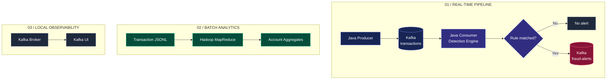
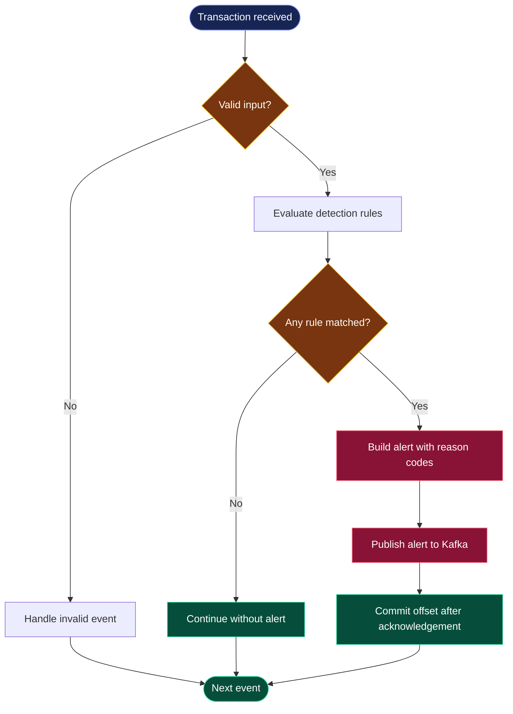

 <div align="center">


### SEE THE SIGNAL. EXPLAIN THE ALERT.

**Real-time transaction monitoring powered by Java, Apache Kafka, and Hadoop MapReduce.**

An engineering project exploring event streaming, explainable detection rules, and distributed analytics.

<br/>

[](https://www.java.com/)
[](https://kafka.apache.org/)
[](https://hadoop.apache.org/)
[](https://www.docker.com/)
[](https://maven.apache.org/)

<br/>

**01 — STREAM** &nbsp; → &nbsp; **02 — DETECT** &nbsp; → &nbsp; **03 — EXPLAIN** &nbsp; → &nbsp; **04 — ANALYZE**

<br/>

[Architecture](#-architecture) · [Features](#-features) · [Quick Start](#-quick-start) · [Detection Rules](#-detection-rules)

**Created by Akanksha Deshmukh**

</div>

---

> [!IMPORTANT]
> SENTINEL is an educational portfolio project using synthetic transaction data and illustrative rules. It is not a production fraud prevention service. An alert indicates a rule match, not confirmed fraud.

## ◈ Overview

SENTINEL demonstrates how a transaction monitoring system can ingest events, evaluate detection rules, publish structured alerts, and analyze historical transaction activity.

| Real-time pipeline | Batch analytics |
|:--|:--|
| Java + Apache Kafka | Hadoop MapReduce |
| Transaction event processing | Account-level aggregation |
| Rule-based alert generation | Historical transaction summaries |

## ✦ Features

<table>
<tr>
<td width="50%" valign="top">

### ⚡ Event Streaming

Generate synthetic transactions in Java and transport them through Kafka.

</td>
<td width="50%" valign="top">

### 🛡️ Explainable Detection

Evaluate transactions using configurable rules and readable reason codes.

</td>
</tr>
<tr>
<td width="50%" valign="top">

### 🔔 Structured Alerts

Publish matched transactions to a dedicated Kafka alert topic.

</td>
<td width="50%" valign="top">

### 📊 Batch Analytics

Aggregate transaction counts, total amounts, and maximum amounts by account.

</td>
</tr>
<tr>
<td width="50%" valign="top">

### 🧪 Testing

Use JUnit to verify selected detection behaviors.

</td>
<td width="50%" valign="top">

### 🧰 Local Environment

Use Docker Compose and Kafka UI to inspect the local streaming setup.

</td>
</tr>
</table>

## ◈ Architecture



### Transaction decision flow



*The flowcharts describe the intended workflow. Confirm that your implementation handles invalid events, Kafka acknowledgements, and offset commits as illustrated.*

## ✦ Detection Rules

The documented default threshold is `1000.00`, configurable through `FRAUD_AMOUNT_THRESHOLD`.

| Rule | Reason code |
|:--|:--|
| Amount meets or exceeds the threshold | `HIGH_AMOUNT` |
| Amount is missing or null | `MISSING_AMOUNT` |
| Amount cannot be parsed | `INVALID_AMOUNT` |
| Amount is negative | `NEGATIVE_AMOUNT` |
| Transaction ID is missing | `MISSING_TRANSACTION_ID` |
| Account ID is missing | `MISSING_ACCOUNT_ID` |

A high-value transaction may be legitimate. These rules demonstrate detection logic rather than establish real-world fraud.

## ⚡ Quick Start

### Prerequisites

- JDK 11
- Maven 3.8+
- Docker Desktop or Docker Engine with Compose
- Hadoop 3.3.x for batch analytics

### 01 — Start the environment

```bash
docker compose up -d
docker compose ps
```

Open Kafka UI if configured:

[http://localhost:8080](http://localhost:8080)

### 02 — Build the project

```bash
mvn clean package
```

### 03 — Start the consumer

```bash
java -jar consumer/target/consumer-1.0.0.jar
```

### 04 — Produce transactions

Open another terminal:

```bash
java -jar producer/target/producer-1.0.0.jar
```

### 05 — Inspect alerts

In Kafka UI, open the `fraud-alerts` topic and inspect published messages and their reason codes.

### 06 — Run tests

```bash
mvn test
```

### 07 — Stop services

```bash
docker compose down
```

> **Setup note:** These commands assume the JAR names, topic configuration, and environment variables match your actual source code. Verify them before publishing the README.

## ◈ Hadoop MapReduce

The batch analytics job processes newline-delimited JSON transaction records and summarizes activity by account.

```bash
hadoop jar mapreduce/target/mapreduce-1.0.0.jar \
  com.akanksha.fraud.mapreduce.TransactionAggregationJob \
  sample-data/transactions.jsonl \
  output/account-aggregates
```

Expected aggregate fields:

- Transaction count
- Total transaction amount
- Maximum transaction amount

Run this command with Hadoop configured for your environment. The output directory must not already exist.

## ◈ Technology Stack

| Technology | Responsibility |
|:--|:--|
| Java 11 | Event generation and detection logic |
| Apache Kafka | Event transport and alert streaming |
| Hadoop MapReduce | Historical aggregation |
| Maven | Build and dependencies |
| Docker Compose | Local infrastructure |
| JUnit | Automated tests |

## ◈ Project Structure

```text
real-time-fraud-detection-system/
├── producer/
├── consumer/
│   └── src/test/
├── mapreduce/
├── sample-data/
├── docker-compose.yml
├── pom.xml
└── README.md
```

The directory overview is abbreviated. Expand it if readers need to navigate specific Java source files.

## ✦ Reliability & Engineering

- The producer's delivery settings and consumer offset management should be documented according to the actual code.
- At-least-once processing can produce duplicate alerts if a crash occurs between alert publication and offset commitment.
- The single-broker development environment is not highly available.
- Malformed-event handling, retries, and dead-letter processing should be verified before claiming production-grade reliability.

## ◈ Roadmap

- [ ] Spring Boot REST API for alert search
- [ ] PostgreSQL persistence
- [ ] Responsive monitoring dashboard
- [ ] Retry and dead-letter handling
- [ ] Alert deduplication
- [ ] Schema validation
- [ ] Account-based velocity rules
- [ ] Throughput and consumer-lag monitoring
- [ ] CI pipeline and dependency scanning
- [ ] Evaluation using labeled data and false-positive metrics

## 🔐 Responsible Use

- Use synthetic transaction data.
- Never commit credentials or sensitive financial information.
- Treat alerts as investigation signals, not proof of fraud.
- Do not use illustrative rules for real financial decisions.

## License

No license has been selected yet. Add an appropriate `LICENSE` file if you intend to grant others permission to reuse the project.

---

<div align="center">


**SENTINEL**

*Streaming systems · Distributed processing · Explainable detection*

**Akanksha Deshmukh**

[](https://github.com/akankshad1712)

</div>
