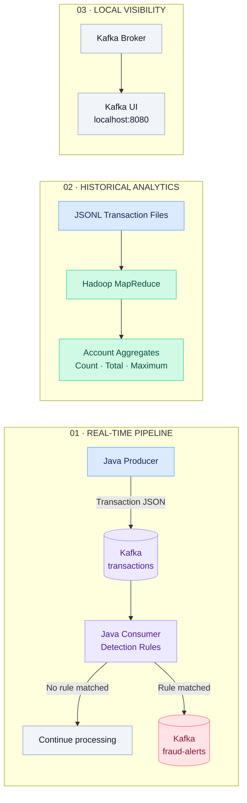
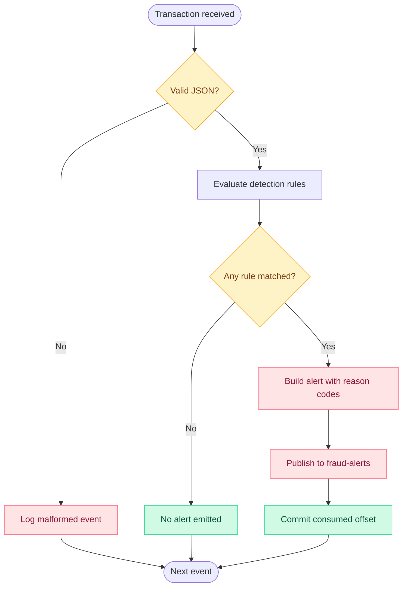

<div align="center">


<br/>

# SEE THE SIGNAL. EXPLAIN THE ALERT.

**An event-driven fraud detection platform built with Java, Apache Kafka, and Hadoop MapReduce.**

Designed to demonstrate real-time event processing, transparent detection rules, and distributed batch analytics.

<br/>

[](https://www.java.com/)
[](https://kafka.apache.org/)
[](https://hadoop.apache.org/)
[](https://www.docker.com/)
[](https://maven.apache.org/)

<br/>

**[Architecture](#-architecture) · [Features](#-core-capabilities) · [Quick Start](#-quick-start) · [Detection Rules](#-detection-engine) · [Roadmap](#-roadmap)**

<br/>


<br/><br/>

**Created by Akanksha Deshmukh**

</div>

---

> [!IMPORTANT]
> **Project scope:** SENTINEL is an educational engineering and portfolio project using synthetic transaction data and illustrative rules. It is not a production fraud prevention service. A flagged transaction is not proof of fraud.

## ◈ 01 — The vision

Financial transactions move continuously. The challenge is not simply to identify an unusually large amount. A useful monitoring pipeline must process events, explain why a rule matched, and retain enough context to support investigation.

**SENTINEL explores that workflow through an event-driven architecture.**

It combines a Kafka-based streaming pipeline with a separate Hadoop MapReduce analytics path, demonstrating how real-time event processing and historical aggregation can coexist in one project.

<div align="center">

| STREAM | DETECT | EXPLAIN | ANALYZE |
|:---:|:---:|:---:|:---:|
| Kafka events | Java rules | Reason codes | MapReduce |

</div>

## ✦ 02 — Core capabilities

<table>
<tr>
<td width="50%" valign="top">

### ⚡ Real-time ingestion

Produce synthetic transaction events with Java and send them to Apache Kafka for downstream processing.

**Key concepts**
- Event-driven architecture
- Kafka producer and consumer APIs
- Transaction topic

</td>
<td width="50%" valign="top">

### 🛡️ Explainable detection

Evaluate incoming events with simple, configurable rules and produce human-readable reasons when a rule matches.

**Key concepts**
- Threshold-based detection
- Input validation
- Explicit reason codes

</td>
</tr>
<tr>
<td width="50%" valign="top">

### 🔔 Structured fraud alerts

Publish matched events to a dedicated Kafka topic, preserving transaction context and source metadata for inspection.

**Key concepts**
- Alert event structure
- Source partition and offset
- Acknowledged publication

</td>
<td width="50%" valign="top">

### 📊 Historical analytics

Use Hadoop MapReduce to summarize transaction history by account.

**Key concepts**
- Distributed batch processing
- Transaction count
- Total and maximum amount

</td>
</tr>
<tr>
<td width="50%" valign="top">

### 🧪 Automated tests

Use JUnit to verify selected rule behaviors, including threshold detection and missing amounts.

</td>
<td width="50%" valign="top">

### 🧰 Local development

Use Docker Compose and Kafka UI to run and inspect the local Kafka environment.

</td>
</tr>
</table>

## ◈ 03 — Architecture



### How the detection flow works



### Technology responsibilities

| Component | Technology | Responsibility |
|---|---|---|
| Transaction producer | Java 11 | Generate synthetic transaction events |
| Event transport | Apache Kafka | Buffer and distribute event streams |
| Detection consumer | Java 11 | Consume transactions and evaluate rules |
| Alert stream | Kafka topic | Carry structured alert events |
| Batch analytics | Hadoop MapReduce | Aggregate historical activity by account |
| Local infrastructure | Docker Compose | Run development services |
| Build and testing | Maven, JUnit | Build modules and test selected behavior |

## ✦ 04 — Detection engine

The demo uses a configurable threshold. Its default is `1000.00` in the transaction's declared currency, and the sample producer uses INR.

| Detection rule | Condition | Reason code |
|---|---|---|
| High amount | Amount is greater than or equal to the configured threshold | `HIGH_AMOUNT` |
| Missing amount | `amount` is absent or null | `MISSING_AMOUNT` |
| Invalid amount | Amount cannot be parsed as a decimal | `INVALID_AMOUNT` |
| Negative amount | Amount is below zero | `NEGATIVE_AMOUNT` |
| Missing transaction ID | Transaction ID is blank or absent | `MISSING_TRANSACTION_ID` |
| Missing account ID | Account ID is blank or absent | `MISSING_ACCOUNT_ID` |

Configure the threshold with `FRAUD_AMOUNT_THRESHOLD`.

> **Design principle:** a rule match should be explainable, but explainability alone does not make a rule accurate. A large transaction may be legitimate. Real fraud detection needs contextual signals, calibrated rules, labeled evaluation data, and false-positive analysis.

## ◈ 05 — Repository structure

```text
real-time-fraud-detection-system/
├── producer/
│   ├── pom.xml
│   └── src/main/java/com/akanksha/fraud/producer/
│       └── TransactionProducer.java
├── consumer/
│   ├── pom.xml
│   ├── src/main/java/com/akanksha/fraud/consumer/
│   │   ├── FraudDetector.java
│   │   └── TransactionConsumer.java
│   └── src/test/java/com/akanksha/fraud/consumer/
│       └── FraudDetectorTest.java
├── mapreduce/
│   ├── pom.xml
│   └── src/main/java/com/akanksha/fraud/mapreduce/
│       └── TransactionAggregationJob.java
├── sample-data/
│   └── transactions.jsonl
├── docker-compose.yml
├── pom.xml
└── README.md
```

## ⚡ 06 — Quick start

### Prerequisites

Install the following tools:

- **JDK 11**
- **Maven 3.8+**
- **Docker Desktop** or Docker Engine with Compose
- **Hadoop 3.3.x**, only if running the MapReduce job

Verify the installations:

```bash
java -version
mvn -version
docker --version
docker compose version
```

### Step 1 — Start the local environment

Run these commands from the repository root:

```bash
docker compose up -d
docker compose ps
```

Open **Kafka UI** in your browser:

[http://localhost:8080](http://localhost:8080)

### Step 2 — Create Kafka topics

```bash
docker compose exec kafka kafka-topics \
  --bootstrap-server kafka:29092 \
  --create --if-not-exists \
  --topic transactions --partitions 3 --replication-factor 1

docker compose exec kafka kafka-topics \
  --bootstrap-server kafka:29092 \
  --create --if-not-exists \
  --topic fraud-alerts --partitions 3 --replication-factor 1
```

### Step 3 — Build the project

```bash
mvn clean package
```

### Step 4 — Start the fraud detector

Open a terminal at the project root:

```bash
java -jar consumer/target/consumer-1.0.0.jar
```

The consumer should report the input topic and configured threshold. If it fails to start, inspect the exception and verify the Kafka broker and topic configuration.

### Step 5 — Produce synthetic transactions

Open a second terminal:

```bash
java -jar producer/target/producer-1.0.0.jar
```

**Windows PowerShell configuration:**

```powershell
$env:TRANSACTION_COUNT = "500"
$env:PRODUCER_DELAY_MS = "50"
java -jar producer/target/producer-1.0.0.jar
```

To configure the threshold in the consumer's terminal:

```powershell
$env:FRAUD_AMOUNT_THRESHOLD = "1500.00"
java -jar consumer/target/consumer-1.0.0.jar
```

### Step 6 — Inspect the alert stream

In Kafka UI:

1. Open the `fraud-alerts` topic.
2. Inspect a published message.
3. Review the `reasons` array to identify the matched rule.
4. Inspect the source topic, partition, and offset.

### Step 7 — Shut down

```bash
docker compose down
```

Use `docker compose down -v` only when you intentionally want to remove Compose-managed volumes and their stored data.

## 📊 07 — Hadoop MapReduce analytics

The MapReduce job processes newline-delimited JSON transaction records and aggregates activity per account.

### Local execution

With Hadoop configured for local execution:

```bash
hadoop jar mapreduce/target/mapreduce-1.0.0.jar \
  com.akanksha.fraud.mapreduce.TransactionAggregationJob \
  sample-data/transactions.jsonl \
  output/account-aggregates
```

If required by your Hadoop configuration:

```bash
hadoop jar mapreduce/target/mapreduce-1.0.0.jar \
  -Dfs.defaultFS=file:/// \
  -Dmapreduce.framework.name=local \
  com.akanksha.fraud.mapreduce.TransactionAggregationJob \
  sample-data/transactions.jsonl \
  output/account-aggregates
```

The output directory must not already exist before the job runs.

### HDFS execution

```bash
hdfs dfs -mkdir -p /fraud/input
hdfs dfs -put -f sample-data/transactions.jsonl /fraud/input/

hadoop jar mapreduce/target/mapreduce-1.0.0.jar \
  com.akanksha.fraud.mapreduce.TransactionAggregationJob \
  /fraud/input \
  /fraud/output/account-aggregates

hdfs dfs -cat /fraud/output/account-aggregates/part-r-00000
```

The job is intended to report per-account transaction count, total amount, and maximum amount.

> [!NOTE]
> The demo mapper uses lightweight extraction for simple JSONL records. For nested JSON, escaped strings, or evolving schemas, use a robust parser such as Jackson and define an explicit invalid-record path.

## 🧪 08 — Tests and verification

Run the consumer module's tests:

```bash
mvn -pl consumer test
```

Run the full build and test suite:

```bash
mvn clean package
mvn test
```

The existing tests cover selected behaviors, including threshold detection, a normal transaction, and a missing amount.

**Before presenting the project as fully working, run the build and tests locally and verify the Kafka and MapReduce workflows in your environment.**

## ◈ 09 — Event contracts

### Transaction event

**Topic:** `transactions`

```json
{
  "transactionId": "tx-001",
  "accountId": "acct-1001",
  "amount": 1000.00,
  "merchant": "electronics",
  "timestamp": "2026-10-21T10:00:00Z",
  "currency": "INR"
}
```

| Field | Type | Description |
|---|---|---|
| `transactionId` | String | Unique transaction identifier |
| `accountId` | String | Account associated with the event |
| `amount` | Decimal number | Transaction amount |
| `merchant` | String | Merchant category or label |
| `timestamp` | ISO-8601 string | Event timestamp |
| `currency` | String | Currency code, such as `INR` |

### Fraud alert event

**Topic:** `fraud-alerts`

```json
{
  "alertId": "generated-uuid",
  "detectedAt": "2026-10-21T10:00:01Z",
  "sourceTopic": "transactions",
  "sourcePartition": 0,
  "sourceOffset": 42,
  "reasons": ["HIGH_AMOUNT"],
  "transaction": {
    "transactionId": "tx-001",
    "accountId": "acct-1001",
    "amount": 1000.00,
    "merchant": "electronics",
    "timestamp": "2026-10-21T10:00:00Z",
    "currency": "INR"
  }
}
```

The alert includes the original transaction and reason codes, allowing downstream tools to show why the event was flagged.

## ◈ 10 — Reliability and engineering decisions

- The producer is configured with `acks=all` and idempotence.
- Consumer auto-commit is disabled.
- The consumer waits for alert publication acknowledgement before committing consumed offsets.
- Source topic, partition, and offset are included for traceability.
- Delivery is **at least once**, not exactly once. A crash after publishing an alert but before committing the offset may result in a duplicate alert.
- Malformed events are currently logged. A stronger implementation should add a dead-letter topic and bounded retry policies.
- The single-broker Docker environment is for local development, not high availability.
- The current rules are illustrative and should not be used for real financial decisions.

## ✦ 11 — Roadmap

- [ ] Add a Spring Boot REST API for alert search and case review.
- [ ] Persist alerts in PostgreSQL or HBase.
- [ ] Build a responsive dashboard for event volume, alert rate, and processing latency.
- [ ] Add dead-letter handling and bounded retries.
- [ ] Add idempotent alert storage and deduplication.
- [ ] Add schema validation with Avro or Protobuf and a schema registry.
- [ ] Add rolling-window velocity rules by account or device.
- [ ] Add metrics for throughput, consumer lag, and false-positive rate.
- [ ] Add CI checks, dependency scanning, container hardening, and secure configuration.
- [ ] Evaluate rules using labeled data, precision, recall, and false-positive rate.

## 🔐 12 — Security and responsible use

- Use synthetic transaction data for demonstrations.
- Never commit credentials, payment data, or personally identifiable information.
- Do not use the sample threshold as a real fraud policy.
- A real deployment requires access control, encryption, audit logging, retention controls, monitoring, and human review.

## 🤝 13 — Contributing

Improvements and thoughtful technical feedback are welcome.

1. Create a focused branch.
2. Make a small, testable change.
3. Run `mvn clean package` and the relevant tests.
4. Update the documentation when behavior or configuration changes.
5. Open a pull request describing the design decision and test evidence.

## License

No license has been selected yet. Add a `LICENSE` file before publishing the repository for reuse. Until then, do not assume others have permission to redistribute or modify the project.

---

<div align="center">


<br/>

### **SENTINEL**

*Streaming systems · Distributed processing · Explainable detection*

**Created by Akanksha Deshmukh**

<br/>

[](https://github.com/akankshad1712)

</div>
