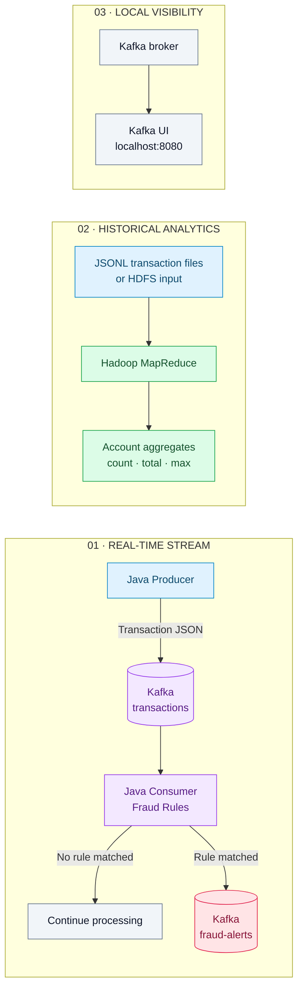
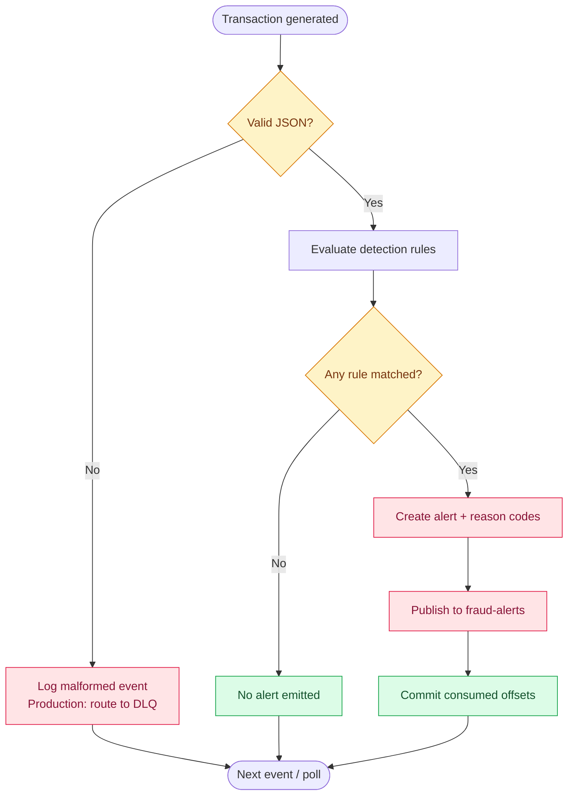

<div align="center">

# ◈ SENTINEL
### Real-Time Fraud Detection Platform

**A streaming-first fraud analytics system built for speed, clarity, and explainability.**

Java 11 · Apache Kafka · Hadoop MapReduce · Maven · Docker

<br/>


[Architecture](#-architecture) · [Quick Start](#-quick-start) · [Features](#-what-it-does) · [API & Events](#-event-contracts) · [Roadmap](#-roadmap)

<br/>

> **Project concept:** detect suspicious activity as transactions stream in, publish explainable alerts, and analyze historical transaction patterns in batch.

</div>

---

## ✦ Product vision

Financial events arrive continuously. A useful detection pipeline needs to do more than inspect a number: it needs to process events reliably, explain why an event was flagged, and make historical patterns easier to investigate.

**Sentinel** is a developer-focused portfolio project demonstrating those core building blocks:

- **Stream** synthetic transactions through Kafka.
- **Evaluate** events with small, explainable Java rules.
- **Alert** by publishing structured fraud events to a dedicated topic.
- **Analyze** transaction history with a Hadoop MapReduce job.
- **Inspect** the local Kafka environment through a lightweight web UI.

> **Important:** Sentinel is an educational demonstration, not a production payment-control system. Its threshold-based rules are not proof of fraud and should never be used to decline real transactions.

## ◈ Architecture



### Event lifecycle



### System boundaries

| Layer | Technology | Responsibility |
|---|---|---|
| Event generation | Java 11, Kafka Producer API | Produce synthetic transaction events |
| Event transport | Apache Kafka | Buffer and distribute transaction streams |
| Detection | Java 11, Kafka Consumer API | Evaluate rules and produce alert events |
| Batch analytics | Hadoop MapReduce | Aggregate transactions per account |
| Local observability | Kafka UI | Inspect topics and messages while developing |
| Build | Maven | Compile modules, run tests, package JARs |

## ✦ What it does

<table>
  <tr>
    <td width="50%">
      <h3>⚡ Streaming ingestion</h3>
      Sends transaction events to Kafka using keyed records and reliable producer settings.
    </td>
    <td width="50%">
      <h3>🛡 Explainable rules</h3>
      Flags suspicious events with human-readable reason codes instead of a mysterious score.
    </td>
  </tr>
  <tr>
    <td width="50%">
      <h3>🔔 Dedicated alert stream</h3>
      Publishes structured alerts to <code>fraud-alerts</code> for downstream investigation tools.
    </td>
    <td width="50%">
      <h3>📊 Batch analytics</h3>
      Calculates per-account transaction count, total amount, and maximum amount.
    </td>
  </tr>
  <tr>
    <td width="50%">
      <h3>🧪 Automated rule tests</h3>
      Includes unit tests for threshold detection, ordinary transactions, and missing amounts.
    </td>
    <td width="50%">
      <h3>🧰 Local developer setup</h3>
      Starts Kafka and Kafka UI through Docker Compose for a repeatable demo environment.
    </td>
  </tr>
</table>

## ✦ Detection rules

The default threshold is `1000.00` in the transaction's declared currency. The demo producer uses INR.

| Rule | Trigger | Reason code |
|---|---|---|
| High amount | Amount is greater than or equal to configured threshold | `HIGH_AMOUNT` |
| Missing amount | `amount` is missing or null | `MISSING_AMOUNT` |
| Invalid amount | Amount cannot be parsed as a decimal | `INVALID_AMOUNT` |
| Negative amount | Amount is below zero | `NEGATIVE_AMOUNT` |
| Missing transaction ID | ID is blank or missing | `MISSING_TRANSACTION_ID` |
| Missing account ID | Account ID is blank or missing | `MISSING_ACCOUNT_ID` |

Configure the threshold with `FRAUD_AMOUNT_THRESHOLD`. This is intentionally a simple baseline: a large amount alone does **not** mean a transaction is fraudulent.

## ◈ Repository map

```text
real-time-fraud-detection-system/
├── producer/
│   ├── pom.xml
│   └── src/main/java/com/akanksha/fraud/producer/
│       └── TransactionProducer.java
├── consumer/
│   ├── pom.xml
│   └── src/main/java/com/akanksha/fraud/consumer/
│       ├── FraudDetector.java
│       └── TransactionConsumer.java
│   └── src/test/java/com/akanksha/fraud/consumer/
│       └── FraudDetectorTest.java
├── mapreduce/
│   ├── pom.xml
│   └── src/main/java/com/akanksha/fraud/mapreduce/
│       └── TransactionAggregationJob.java
├── sample-data/
│   └── transactions.jsonl
├── docker-compose.yml
├── pom.xml
└── README.md
```

## ✦ Quick start

### Prerequisites

Install the following before starting:

- **JDK 11**
- **Maven 3.8+**
- **Docker Desktop** or Docker Engine with Compose
- **Hadoop 3.3.x** only for running the MapReduce job

Verify your tools:

```bash
java -version
mvn -version
docker --version
docker compose version
```

### 1 — Start the local infrastructure

From the repository root:

```bash
docker compose up -d
docker compose ps
```

Open **Kafka UI** at [http://localhost:8080](http://localhost:8080).

### 2 — Create Kafka topics

```bash
docker compose exec kafka kafka-topics \
  --bootstrap-server kafka:29092 \
  --create --if-not-exists \
  --topic transactions --partitions 3 --replication-factor 1

docker compose exec kafka kafka-topics \
  --bootstrap-server kafka:29092 \
  --create --if-not-exists \
  --topic fraud-alerts --partitions 3 --replication-factor 1
```

### 3 — Build the project

```bash
mvn clean package
```

### 4 — Start the fraud detector

Open a terminal at the project root:

```bash
java -jar consumer/target/consumer-1.0.0.jar
```

Expected startup log:

```text
Fraud detector listening on transactions; threshold=1000.00
```

### 5 — Generate transactions

Open a second terminal:

```bash
java -jar producer/target/producer-1.0.0.jar
```

The producer sends 100 sample events by default. Every tenth event is deliberately generated with an amount of `1000.00`, so the alert path is easy to demonstrate.

Optional configuration:

```bash
TRANSACTION_COUNT=500 \
PRODUCER_DELAY_MS=50 \
java -jar producer/target/producer-1.0.0.jar
```

Set a custom threshold for the consumer:

```bash
FRAUD_AMOUNT_THRESHOLD=1500.00 \
java -jar consumer/target/consumer-1.0.0.jar
```

**Windows PowerShell:**

```powershell
$env:TRANSACTION_COUNT="500"
$env:PRODUCER_DELAY_MS="50"
java -jar producer/target/producer-1.0.0.jar
```

### 6 — Inspect the alerts

In Kafka UI:

1. Open the `fraud-alerts` topic.
2. Inspect a message.
3. Review `reasons` to understand why it was flagged.
4. Check source topic, partition, and offset for traceability.

Stop the local services when finished:

```bash
docker compose down
```

## ✦ Batch analytics with Hadoop MapReduce

The MapReduce job processes newline-delimited JSON transaction files and outputs aggregates per account.

### Run in local mode

From the repository root, with Hadoop configured for local execution:

```bash
hadoop jar mapreduce/target/mapreduce-1.0.0.jar \
  com.akanksha.fraud.mapreduce.TransactionAggregationJob \
  sample-data/transactions.jsonl \
  output/account-aggregates
```

If necessary, pass local-mode properties before the main class:

```bash
hadoop jar mapreduce/target/mapreduce-1.0.0.jar \
  -Dfs.defaultFS=file:/// \
  -Dmapreduce.framework.name=local \
  com.akanksha.fraud.mapreduce.TransactionAggregationJob \
  sample-data/transactions.jsonl \
  output/account-aggregates
```

The output directory must not already exist. Remove it before rerunning the same job.

### Run against HDFS

```bash
hdfs dfs -mkdir -p /fraud/input
hdfs dfs -put -f sample-data/transactions.jsonl /fraud/input/

hadoop jar mapreduce/target/mapreduce-1.0.0.jar \
  com.akanksha.fraud.mapreduce.TransactionAggregationJob \
  /fraud/input \
  /fraud/output/account-aggregates

hdfs dfs -cat /fraud/output/account-aggregates/part-r-00000
```

Example output shape:

```text
acct-1001    transactionCount=2    totalAmount=207.75    maxAmount=125.50
acct-1002    transactionCount=2    totalAmount=1045.00   maxAmount=1000.00
acct-1003    transactionCount=1    totalAmount=2500.00   maxAmount=2500.00
```

> **Parsing limitation:** the demo MapReduce mapper uses a lightweight extractor for simple JSONL records. For arbitrary or nested JSON, escaped strings, and schema changes, use a robust JSON parser such as Jackson in the mapper and route invalid rows to a clearly defined error path.

## ✦ Test the detection rules

Run the consumer module's unit tests:

```bash
mvn -pl consumer test
```

Current test coverage includes:

- Amount exactly at the threshold is flagged.
- A normal amount is not flagged.
- A missing amount is flagged.

## ✦ Event contracts

### Transaction event

Topic: `transactions`

```json
{
  "transactionId": "tx-001",
  "accountId": "acct-1001",
  "amount": 1000.00,
  "merchant": "electronics",
  "timestamp": "2026-10-21T10:00:00Z",
  "currency": "INR"
}
```

| Field | Type | Meaning |
|---|---|---|
| `transactionId` | string | Unique identifier for the transaction |
| `accountId` | string | Account associated with the event |
| `amount` | decimal number | Transaction amount |
| `merchant` | string | Merchant category or label |
| `timestamp` | ISO-8601 string | Event timestamp |
| `currency` | string | Currency code, e.g. `INR` |

### Fraud alert event

Topic: `fraud-alerts`

```json
{
  "alertId": "generated-uuid",
  "detectedAt": "2026-10-21T10:00:01Z",
  "sourceTopic": "transactions",
  "sourcePartition": 0,
  "sourceOffset": 42,
  "reasons": ["HIGH_AMOUNT"],
  "transaction": {
    "transactionId": "tx-001",
    "accountId": "acct-1001",
    "amount": 1000.00,
    "merchant": "electronics",
    "timestamp": "2026-10-21T10:00:00Z",
    "currency": "INR"
  }
}
```

The alert contains both the original transaction and reason codes so a downstream service can display an explainable case.

## ◈ Reliability & engineering notes

- Producer configuration enables `acks=all` and idempotence.
- Consumer auto-commit is disabled.
- The consumer waits for alert publish acknowledgements before committing consumed offsets.
- Source topic, partition, and offset are included in alerts for traceability.
- The processing approach is **at least once**, not exactly once. A crash after publishing an alert but before committing offsets can cause duplicate alerts.
- Malformed events are currently logged. A production version should route them to a dead-letter topic and define retry limits.
- The single-broker Docker setup is for local development, not high availability.
- The current rules are illustrative; thresholds must be calibrated and evaluated before use in any real decision process.

## ✦ Roadmap

- [ ] Add a Spring Boot REST API for alert search and case review.
- [ ] Persist alerts in PostgreSQL or HBase.
- [ ] Add a responsive monitoring dashboard with event volume, alert rate, and processing latency.
- [ ] Add dead-letter handling and bounded retry policies.
- [ ] Add idempotent alert storage and deduplication.
- [ ] Add schema validation with Avro or Protobuf and a schema registry.
- [ ] Add rolling-window velocity rules by account or device.
- [ ] Add metrics for throughput, consumer lag, and false-positive rate.
- [ ] Add CI checks, dependency scanning, container hardening, and secure configuration.
- [ ] Evaluate rules against labeled data using precision, recall, and false-positive rate.

## ✦ Security & responsible use

- Use synthetic transactions only in this demo.
- Never commit credentials, payment data, or personally identifiable information.
- Do not use the sample threshold as a real fraud policy.
- A real deployment requires access control, encryption, audit logging, retention controls, monitoring, and human review.

## ✦ Contributing

Contributions are welcome. For a clean workflow:

1. Create a focused branch.
2. Make a small, testable change.
3. Run `mvn clean package`.
4. Update the README when behavior or configuration changes.
5. Open a pull request describing the design decision and test evidence.

## License

No license has been selected yet. Add a `LICENSE` file before publishing this repository for reuse.

---

<div align="center">

**Built to demonstrate streaming systems, explainable rules, and batch analytics.**

<sub>Sentinel · Real-Time Fraud Detection Platform · Portfolio project</sub>

</div>
